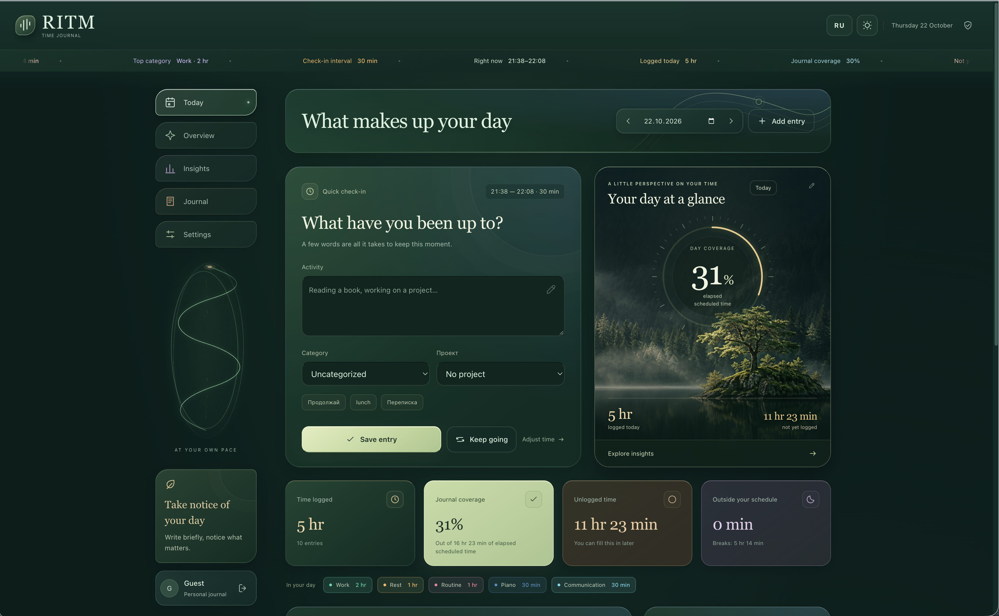

[English](README.md) · **Русский** · [简体中文](README.zh-CN.md)

# Ритм — куда уходит время

[](https://ritmday.space/)

## Попробуйте Ритм в браузере

[Откройте сайт Ритма](https://ritmday.space/), чтобы посмотреть, как выглядит и работает приложение, без установки. Выберите режим **«Гость»** на экране входа, чтобы познакомиться с дневником времени, графиками и настройками на примере демонстрационных данных. Гостевой просмотр открывается без пароля.

Ритм — дневник времени с сайтом, базой SQLite и необязательным Telegram-ботом, который разворачивается на вашем компьютере или сервере. Короткая запись каждые 30 минут помогает замечать, куда уходит день, без постоянной гонки за продуктивностью.

Запишите пару слов на сайте или ответьте в Telegram. Записи складываются в ленту дня, распределение времени и тенденции по дням и месяцам. Аккаунт ChatGPT, API искусственного интеллекта и подписка на языковую модель не нужны.

**У каждой установки своя база данных.** Копирование репозитория не подключает ваш журнал к серверу автора. Для Telegram используйте собственный токен бота.

## Возможности

- Записи с сайта и из Telegram; вопросы каждые 15, 30 или 60 минут в выбранные часы и дни.
- Утром бот предлагает «Только что» или «Другое время» с ручным вводом ЧЧ:ММ. После подъёма опросы идут с выбранным шагом; кнопка «Отбой» завершает их на день.
- Несколько занятий в одном интервале: новые сообщения дополняют предыдущие, а минуты не считаются повторно.
- Редактирование прошлых записей и отдельных занятий, разделение интервалов и заполнение пропусков.
- Создание, переименование, выбор цвета, архивирование и удаление категорий; при удалении прежние занятия сохраняются без категории, а новые вопросы бота больше её не показывают.
- Просмотр статистики за день, неделю или месяц; возможность выключить поля и графики проектов без удаления прежних связей.
- Переключение языка бота через кнопку «Настройки» → «Язык».
- Выбор целевых категорий и просмотр тенденций по дням или месяцам.
- Поиск города для выбора часового пояса. Прошлые дни сохраняют исходное расписание и часовой пояс.
- Английский и русский интерфейсы, светлая и тёмная темы, адаптация под компьютер и телефон.
- Гостевая демонстрация без пароля с двенадцатью скользящими месяцами разнообразных вымышленных записей, восемью категориями и тремя проектами.
- Экспорт и импорт JSON, CSV по выбранным фильтрам и проверенные резервные копии SQLite.

## Локальный запуск

Нужен **Node.js версии 22.18 или новее**. Устанавливать сторонние зависимости для работы приложения не требуется.

```bash
git clone https://github.com/mr-svet/ritm.git
cd ritm
npm run setup
npm start
```

Откройте **[http://127.0.0.1:4173/](http://127.0.0.1:4173/)**.

`setup` создаёт учётную запись владельца и один раз показывает случайный пароль. Сохраните его в менеджере паролей. Повторный запуск не меняет существующий пароль. Команда `npm run reset-password` создаёт новый пароль владельца и завершает активные сеансы, сохраняя записи журнала.

Пока пользуетесь журналом, сервер должен работать. Для остановки нажмите **Ctrl+C**. Если порт 4173 занят, остановите занимающий его процесс или выберите другой порт:

```bash
PORT=4174 npm start
```

Локальный сервер слушает `127.0.0.1`, поэтому доступен только на компьютере, где запущен. Для работы с других устройств и отправки вопросов при выключенном компьютере разместите приложение на постоянно работающем сервере.

## Подключение своего Telegram-бота

1. Откройте официального [@BotFather](https://t.me/BotFather), отправьте `/newbot` и следуйте инструкциям. Для локальной разработки используйте отдельного бота без настроенного webhook.
2. Скопируйте [`.env.example`](.env.example) в `.env`, если такого файла ещё нет. Добавьте токен локально:

   ```dotenv
   TELEGRAM_BOT_TOKEN=your_botfather_token
   ```

3. Перезапустите `npm start`. Сайт и база работают и без токена бота.
4. Войдите как владелец и откройте **Настройки → Telegram → Подключить Telegram**. Перейдите по одноразовой ссылке и нажмите **«Запустить»** в Telegram. Ссылка действует 10 минут.
5. Выберите часовой пояс, часы и дни учёта, затем сохраните расписание. Если за сегодня уже есть записи или паузы, изменения действуют со следующего дня.

Токен остаётся на сервере. Не добавляйте `.env`, базы и резервные копии в Git, скриншоты или переписку. Для одного токена должен работать только **один процесс бота**: перед использованием этого токена на сервере остановите локальный экземпляр.

### Логика опросов

Вопрос по расписанию относится к только что завершившемуся интервалу, даже если вы уже что-то записали за это время. Выберите категорию: если выбрана «Работа» и проекты включены, можно нажать на название проекта — оно сразу станет занятием, либо выбрать «Свой ответ» и написать описание. Для других категорий отправьте короткий текст. До сохранения категорию можно изменить кнопками исходного вопроса. После сохранения кнопки исчезнут, а бот ответит «Записал». Выбор привязан к конкретному вопросу и действует 30 минут. Остальные категории доступны через кнопку перехода к следующей странице.

Обычное сообщение без ответа на конкретный вопрос относится к **текущему интервалу** по времени отправки и часовому поясу журнала. После завершённого ответа боту следующее обычное сообщение сначала предлагает выбрать категорию. При шаге 30 минут сообщение в 12:20 относится к 12:00–12:30. Повторные занятия дополняют интервал, не заменяют предыдущие тексты и не заполняют старые пропуски. Ответ на плановый вопрос тоже дополняет ранее сделанную запись этого интервала.

Ответ также дополняет запись с сайта за тот же интервал. Проект сохраняется; явно выбранная категория применяется ко всему интервалу. Длительность отдельных занятий не угадывается, время блока учитывается один раз. Разделённые и частично пересекающиеся интервалы можно редактировать на сайте.

Кнопка продолжения повторяет только последнее отдельное занятие, а не сводку предыдущего интервала. Повторное нажатие не добавляет то же продолжение ещё раз. Ответ на использованный, истёкший или неизвестный запрос категории отклоняется, а не переносится молча в текущий интервал. Новый выбор категории заменяет незавершённый предыдущий выбор и не копирует занятия.

| Команда | Действие |
| --- | --- |
| `/help` | Показать справку |
| `/settings` | Открыть настройки бота и сменить язык |
| `/sleep` | Записать отбой и прекратить вопросы на сегодня |
| `/pause` | Приостановить напоминания на час |
| `/resume` | Возобновить напоминания |
| `/end` | Приостановить учёт до конца дня |
| `/site` | Открыть сайт |

Диктовка клавиатуры работает как обычный текст. Голосовые сообщения не расшифровываются. Язык бота меняется через кнопку «Настройки» или команду `/settings` независимо от языка сайта.

Сайт проверяет обновления каждые пять секунд, когда вы не редактируете форму. Паузы и выходные учитываются; пропуски остаются пустыми. После простоя бот не присылает пачку старых вопросов. Статусы доставки вопроса и сохранения ответа показываются отдельно в настройках.

## Журнал и тенденции

Быстрая запись подставляет текущий интервал в выбранном часовом поясе и обновляет время, не очищая черновик. При необходимости время можно изменить вручную. Прошлые записи сохраняют исходные даты и часы. Текущий интервал можно сохранить до его окончания; полностью будущие интервалы недоступны.

**Журнал → Все записи** открывает историю. Нажмите кнопку редактирования для изменения записи или раскройте список занятий, чтобы изменить отдельные сообщения. Категория и проект относятся ко всему интервалу.

**Общая сводка** находится второй в меню. По умолчанию показаны даты от того же числа прошлого месяца до сегодняшнего дня. Предыдущие даты доступны горизонтальной прокруткой, последний день закреплён рядом с категориями. Нажатие на длительность открывает занятия и интервалы; нажатие на время подъёма или отбоя позволяет исправить его. Строка «Итого» суммирует день без повторного подсчёта нескольких сообщений в одном интервале. Порядок категорий на сайте и в боте общий. Оценочный блок и формула на этом экране больше не показываются.

По умолчанию сайт открывается на русском. Язык, тема и пейзаж сохраняются на устройстве под ключом `ritm-ui-v2`, отдельно от журнала. Переключение языка не переводит и не переписывает личные записи и названия категорий. Даты, длительности, подписи городов и заголовки CSV следуют языку интерфейса.

**«Проверить подключение»** проверяет сервер сайта и показывает успех или ошибку. Кнопка не проверяет Telegram и не запускает сервер.

## Гостевой просмотр

На входе выберите **«Посетитель» → «Открыть демонстрацию»**. Пароль не нужен. Для личного журнала по-прежнему требуется пароль владельца.

Посетитель получает свежий вымышленный журнал. Можно исследовать записи, категории, проекты, расписание и графики. Изменения остаются в памяти вкладки и исчезают после обновления страницы; журнал не читается из браузерного хранилища и не записывается ни туда, ни в базу владельца. Язык и тема устройства сохраняются отдельно.

Гостю недоступны личный API, экспорт, импорт и настоящий Telegram-бот. Ограничения проверяет сервер, а не только интерфейс. Гостевой сеанс действует до двух часов. Сеанс владельца действует до 12 часов.

В одном профиле браузера используется одна текущая роль. Для одновременной проверки владельца и гостя используйте разные профили браузера.

## Данные и резервные копии

База по умолчанию находится в **`data/rhythm.sqlite`**. Каталог можно изменить через `DATA_DIR`. Таблица `entries` хранит записи интервалов; поле `entries.activities` содержит отдельные занятия в формате JSON: идентификаторы, текст и известные UTC-отметки времени сообщений. Подробности бэкенда — в [STAGE-2.md](STAGE-2.md).

```bash
npm run db:entries
npm run db:backup
```

Первая команда показывает последние записи без изменения базы. Вторая создаёт снимок SQLite и проверяет его целостность, включая зафиксированные данные WAL, пока приложение работает. Копии сохраняются в `backups/` или каталог из `BACKUP_DIR`. Храните также отдельную копию за пределами сервера.

Не копируйте только `.sqlite` из работающей базы. Для ручного копирования файлов сначала остановите приложение и скопируйте всю папку `data/`, включая оставшиеся WAL-файлы.

JSON сохраняет отдельные занятия; поддерживается импорт старых журналов версии 1. В CSV один интервал занимает одну строку, поэтому длительности не дублируются. Экспорты и файлы SQLite **не зашифрованы**.

Старый личный журнал браузера не переносится автоматически. Откройте **Настройки → Перенести из браузера** на том же адресе и порте либо экспортируйте JSON из старой версии и импортируйте в серверный журнал. Перед заменой данных скачайте резервную копию. Сообщения, которые были перезаписаны старыми версиями, автоматически не восстанавливаются.

## Предпросмотр без бэкенда

```bash
npm run dev
```

Это статический фронтенд с браузерным хранилищем `ritm-local-v1`, без API базы и настоящего бота. `ritm-preview.html` — автономная HTML-версия этого режима; для пересборки выполните `npm run build`. Этот режим отличается от гостевого просмотра без пароля, который обслуживается бэкендом.

## Размещение на сервере

[Dockerfile](Dockerfile) и [compose.yaml](compose.yaml) рассчитаны на **Dokploy с Docker Compose**. Compose ожидает существующую сеть `dokploy-network` и не является готовой отдельной конфигурацией публичного сервера.

Используйте собственный HTTPS-домен и задайте точный адрес сайта в `APP_ORIGIN`. Свой токен бота добавьте через переменные окружения сервера. Сохраняйте постоянные тома SQLite и резервных копий и запускайте один экземпляр приложения. HTTPS завершается на обратном прокси; внутренний порт приложения нельзя публиковать напрямую.

Пароли хранятся как scrypt-хеши с солью. В production используются Secure, HttpOnly и SameSite cookie, проверки источника запросов и CSRF. Защищайте также сервер, диск и резервные копии: вход по паролю не шифрует хранящийся журнал.

Статус выпусков и оставшиеся проверки описаны в [DEPLOYMENT.md](DEPLOYMENT.md). Приложение рассчитано на одного владельца и гостевые демонстрации, без публичной регистрации и независимых аккаунтов нескольких пользователей. Telegram Mini App пока не реализован.

## Разработка

```bash
npm run check
npm test
npm run build
```

Тесты используют временные базы и имитацию транспорта Telegram. Они не отправляют настоящие сообщения и не меняют личный журнал. После изменения модулей фронтенда или стилей пересоберите автономный HTML.

Границы продукта описаны в [PRD.md](PRD.md). Автоматические тесты не заменяют проверку доставки вопросов и сохранения ответов с вашим настоящим ботом.

### Оформление и адреса

Для новых посетителей язык сайта — русский; английский доступен в переключателе. На странице «Сегодня» можно выбрать один из шести пейзажей для «Картины дня». Выбор языка, темы и пейзажа сохраняется в этом браузере отдельно от журнала. Разделы имеют прямые адреса `/today`, `/journal`, `/stats`, `/trends` и `/settings`. В поиске городов доступны Астана и Алматы (Asia/Almaty).

## Общая сводка и язык бота

В сводке даты стоят по столбцам, категории — по строкам. Число видимых дат зависит от ширины экрана; для перехода к прежним датам есть кнопки. Нажатие на время показывает интервалы и занятия с переходом в журнал. Категории можно перетаскивать или двигать стрелками: порядок применяется и в боте. Кнопка языка показывает `EN` в русском интерфейсе и `RU` в английском. В боте команда `/language` переключает язык отдельно от языка сайта.
